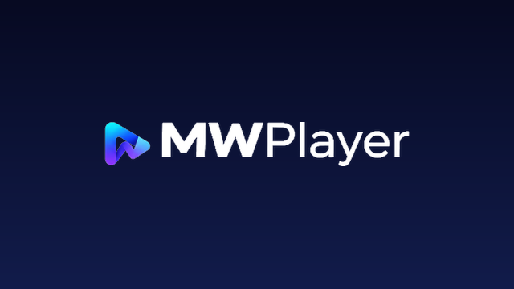

<p align="center">
  
</p>

<h1 align="center">🎬 MWPlayer (Modern Media & Video Player)</h1>

<p align="center">
  <strong>Trình phát đa phương tiện cao cấp và xem phim trực tuyến hiện đại dành cho Android & Android TV.</strong>
</p>

<p align="center">
  <a href="releases/MWPlayer-arm64-v8a.apk"></a>
  <a href="releases/MWPlayer-armeabi-v7a.apk"></a>
</p>

---

## 📥 Tải về Cài đặt (Direct Downloads)

Tải trực tiếp bản APK mới nhất đã được build sẵn từ repository:

| Phiên bản | Kiến trúc CPU | Dung lượng | Tải xuống trực tiếp |
| :--- | :--- | :--- | :--- |
| **MWPlayer arm64-v8a** (Khuyên dùng) | `arm64-v8a` (Hầu hết điện thoại/TV mới) | ~49.4 MB | 🔗 [**Tải file APK (arm64-v8a)**](releases/MWPlayer-arm64-v8a.apk?raw=true) |
| **MWPlayer armeabi-v7a** | `armeabi-v7a` (Máy đời cũ, 32-bit) | ~48.1 MB | 🔗 [**Tải file APK (armeabi-v7a)**](releases/MWPlayer-armeabi-v7a.apk?raw=true) |

> 💡 **Mẹo:** Nếu bạn không rõ kiến trúc máy của mình, hãy tải bản **`arm64-v8a`**. Các thiết bị Android sản xuất từ năm 2017 đến nay đều hỗ trợ `arm64-v8a`.

---

## ✨ Tính năng Nổi bật (Key Features)

### 1. 📺 Xem Phim Trực tuyến (Movie Online)
- **Đa nguồn chất lượng cao:** Tích hợp trực tiếp **KKPhim** và **VSMov** với kho phim khổng lồ: *Phim chiếu rạp, Phim bộ, Phim lẻ, Cổ trang, Hàn Quốc, Trung Quốc, Hoạt hình/Anime, TV Shows, Subteam/Thuyết minh*.
- **Featured Hero Carousel:** Slide banner chuyển tự động mượt mà các phim nổi bật nhất.
- **Quản lý phim toàn diện:**
  - 🎬 **Phim đang xem dở (Continue Watching):** Tự động lưu tiến trình xem, hiển thị thanh tiến trình % và nút *"Tiếp tục xem: Tập X (xx%)"* khôi phục chính xác vị trí đang xem dở.
  - ⭐ **Danh sách theo dõi (Watchlist):** Thêm nhanh vào danh sách theo dõi/yêu thích với nút ⭐, có hàng kệ riêng và tab lọc riêng biệt.
  - 🕒 **Phim xem gần đây (History):** Quản lý toàn bộ lịch sử các tập phim đã phát, hỗ trợ xóa lịch sử một chạm.
- **Kéo phim về Tele Cloud:** Hỗ trợ tải phim trực tuyến và tự động đẩy lưu trữ về kho Telegram Cloud cá nhân (tính năng MovieCloudDownloader).

### 2. ✈️ Nguồn Video Telegram Đỉnh cao
- Đồng bộ mượt mà với tài nguyên video từ Telegram (Saved Messages, channels, groups, supergroups, topics).
- **Bộ lọc & Sắp xếp linh hoạt:**
  - Gộp nút *Mới nhất / Cũ nhất* thành 1 nút toggle chuyển đổi nhanh.
  - Thêm tính năng **Sắp xếp ngẫu nhiên (Random)** để khám phá nội dung mới.
  - Tìm kiếm video siêu tốc theo từ khóa, hashtag, định dạng.
- **Thêm nhanh vào Yêu thích (*):**
  - Tích hợp nút ⭐ trên thanh điều khiển của trình phát.
  - **Tự động Forward thông minh:** Tùy chọn cấu hình tự động forward video yêu thích về một kho tin nhắn / group / channel / topic riêng biệt (hỗ trợ `drop_author = true` giữ trọn sự riêng tư).

### 3. 🎥 Trình phát Video Hiện đại (Advanced Video Player)
- **Tua nhanh thông minh:** Bổ sung cụm phím tua nhanh chuyên dụng **-10m, -1m** (bên trái) và **+1m, +10m** (bên phải) với icon tùy biến sang trọng.
- **Đa âm thanh & Phụ đề:** Tích hợp bộ chọn kênh âm thanh (Audio tracks) và phụ đề ngoài (Subtitles) đa ngôn ngữ.
- **Cử chỉ thông minh:** Vuốt điều chỉnh âm lượng (bên phải), độ sáng (bên trái), vuốt ngang tua thời gian, chạm đúp hai bên để tua 10s.
- **Chế độ phát:** Hỗ trợ Picture-in-Picture (PiP), phát nền khi tắt màn hình (Background playback), xoay ngang/dọc nhanh, khóa màn hình cảm ứng chống chạm nhầm.

### 4. 🎨 Thiết kế Thương hiệu MWPlayer Đồng bộ
- **Giao diện:** Thiết kế giao diện Dark / Light Mode hiện đại, tối ưu độ tương phản và bảo vệ mắt.
- **Màn hình khởi động (Splash Screen):** Áp dụng giao diện Splash Screen 1080x1920 sắc nét với hiệu ứng mờ dần (fade-out) mượt mà khi mở ứng dụng.
- **Icon thích ứng (Adaptive Icon):** Căn giữa và co giãn chuẩn xác theo tỷ lệ an toàn của Android (Safe Zone Circle), không bị méo hình hay cắt góc trên bất kỳ giao diện launcher nào (Samsung OneUI, Google Pixel, Xiaomi HyperOS/MIUI...).
- **Tối ưu Android TV:** Hỗ trợ điều khiển mượt mà bằng Remote D-Pad, banner Android TV chuẩn 16:9.

---

## 🛠 Hướng dẫn Cài đặt

1. Tải file APK từ mục [Tải về Cài đặt](#-tải-về-cài-đặt-direct-downloads) ở trên về điện thoại hoặc Android TV.
2. Mở file APK vừa tải về trên thiết bị.
3. Nếu thiết bị hỏi quyền cài đặt ứng dụng không rõ nguồn gốc:
   - Vào **Cài đặt (Settings)** ➔ **Bảo mật (Security)**.
   - Bật tùy chọn **Cho phép cài đặt ứng dụng từ nguồn này (Install unknown apps)**.
4. Bấm **Cài đặt (Install)** và tận hưởng trải nghiệm xem phim đỉnh cao cùng **MWPlayer**!

---

## 💻 Hướng dẫn Build từ Source Code

Yêu cầu môi trường:
- **JDK:** OpenJDK 17 trở lên.
- **Android SDK:** Compile SDK 37, Min SDK 23.
- **Công cụ:** Gradle Wrapper (đi kèm dự án).

Clone dự án và build file APK:

```bash
# 1. Clone repository
git clone https://github.com/mwuan216/MWPlayer.git
cd MWPlayer

# 2. Build APK Debug
./gradlew assembleDebug

# File APK tạo ra tại: app/build/outputs/apk/debug/
```

---

## 📜 Giấy phép & Bản quyền

- Dự án phát triển dựa trên nền tảng mã nguồn mở hiện đại (Jetpack Compose, AndroidX Media3/ExoPlayer, TDLib).
- Logo, biểu tượng và bộ nhận diện thương hiệu thuộc quyền sở hữu của **MWPlayer**.
